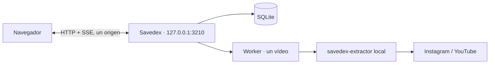

# Savedex

Aplicación web local para guardar vídeos de Instagram y YouTube y consultar sus extracciones con evidencia. Diseño aprobado: [recorrido](docs/design/savedex-recorrido.html).

Estado: **aceptación funcional de v1 cerrada**. Verificación automática: 119/119 pruebas y 18 recorridos de navegador. Lote real de diez URLs: cinco success, dos partial y tres errores. Un caso real adicional de top 10 produjo dos ítems y ocho faltantes; su reprocesado exhaustivo conservó ambos resultados y la revisión requerida. Sigue parcial, sin mejora de recuperación. Detalle, límites y evidencias en [acceptance.md](docs/acceptance.md) y [verificación top N](docs/delivery-7-top-n.json).

## Preparar el entorno en Windows x64

Desde este directorio en PowerShell:

```powershell
.\scripts\setup.ps1
if (-not (Test-Path .env)) { Copy-Item .env.example .env }
.\scripts\start.ps1
```

El instalador usa Node 22.23.4 portable y pnpm 10.6.3 dentro de `.tools`, verifica la descarga oficial e instala con `pnpm-lock.yaml`. No cambia las instalaciones globales ni instala modelos. También puede usarse Node 22.23.4 y pnpm 10.6.3 ya instalados y ejecutar `pnpm install --frozen-lockfile`.

Abre [Savedex local](http://127.0.0.1:3210). El comando compila y sirve interfaz y API desde el mismo puerto. Lee `.env` desde la raíz del proyecto incluso si se inicia desde otra carpeta; las variables ya definidas en el entorno tienen prioridad. Si cambias `PORT`, usa la dirección que imprime el arranque. El backend abre su base y recupera pendientes **sin procesarlos automáticamente**. Pulsa Iniciar en la interfaz.

Windows 10 o posterior, x64 y Windows PowerShell/.NET son necesarios para el supervisor de procesos. El navegador de pruebas es Chrome o Edge; la aplicación requiere JavaScript y EventSource. Detener en la interfaz termina el vídeo activo antes de parar la cola. Ctrl+C solicita el cierre del backend tras ese vídeo; evita forzar su terminación si quieres un cierre normal. Cerrar solo el navegador no detiene las extracciones.

Configura en `.env` las rutas al `.exe`, modelo medium y carpeta de trabajo **ya existentes** de [savedex-extractor](https://github.com/enros7500/savedex-extractor). El repositorio público y su correspondencia con el origen local están [verificados](docs/delivery-7-extractor-link.json). Savedex no instala ni descarga modelos. El CLI debe disponer de sus recursos de voz, texto y OCR; `doctor` comprueba recursos, pero no garantiza el acceso anónimo a cada publicación. No se incorporan cookies ni inicio de sesión.

Los datos cotidianos quedan en `data/savedex.sqlite` por defecto. `.env`, `data/`, `.cache/` y herramientas locales están excluidos por `.gitignore`. Puedes cambiar `SAVEDEX_DATABASE` por una ruta persistente propia. Las rutas relativas se resuelven respecto a Savedex. Para respaldar, detén el servidor y copia la base y sus archivos SQLite asociados. Más detalle: [arquitectura y almacenamiento](docs/architecture.md).



Para desarrollo con recarga: tras compilar una vez, ejecuta `.\scripts\pnpm.ps1 dev`. Angular escucha en `127.0.0.1:4200` y usa el proxy `/api` hacia 3210; ajusta `apps/web/proxy.conf.json` si cambias el puerto del backend. En uso normal basta `start.ps1`. Las [rutas de API](docs/api-and-events.md) también están disponibles sin prefijo por compatibilidad.

## Comprobar el extractor existente

```powershell
.\scripts\pnpm.ps1 extractor:verify
.\scripts\pnpm.ps1 contracts:generate
```

Se espera el repositorio hermano `../savedex-extractor` con su instalación Windows existente en `work/asr-venv`. La verificación usa el ejecutable directamente sin shell, valida fixtures sintéticos, consulta versión y diagnóstico y envía una solicitud inválida controlada. Escribe sus archivos temporales en `.cache` de Savedex. No procesa URLs reales ni modifica el código del extractor. `doctor` comprueba presencia de recursos; no acredita una extracción completa.

Los tipos TypeScript se generan desde copias exactas de sus JSON Schemas 3.0.0. Los esquemas validan estructura y las comprobaciones del extractor validan además las referencias y reglas semánticas. `ProgressEvent` deriva del emisor de progreso, que es un protocolo separado. Las variables se describen en `.env.example`. El presupuesto predeterminado es de 900 segundos más 20 de cierre; un resultado `partial` con salida 2 es válido y conserva sus motivos de revisión.

Decisiones, fuentes oficiales, incidencias resueltas y evidencia: [entrega 1](docs/delivery-1.md). El plan de v1 completo sigue en [el plan aprobado](docs/superpowers/plans/2026-11-11-savedex-v1.md).

Persistencia, reglas de URLs, historial, revisión y evidencia de las 50 pruebas: [entrega 2](docs/delivery-2.md). Su verificación completa se puede repetir con `.\.tools\node-v22.23.4-win-x64\node.exe scripts/verify-delivery-2.mjs`; usa únicamente bases temporales sintéticas y no invoca al extractor.

Lotes congelados, worker secuencial, parada/reanudación, recuperación sin autoarranque y exclusión entre procesos: [entrega 3](docs/delivery-3.md). Verificación: `.\.tools\node-v22.23.4-win-x64\node.exe scripts/verify-delivery-3.mjs`. Ejecuta 70 pruebas y un recorrido del código compilado con bases temporales y extractor simulado; incluye terminar un proceso de prueba para acreditar la recuperación.

Adaptador del CLI, progreso JSONL, watchdog y limpieza del árbol de procesos en Windows 10+: [entrega 4](docs/delivery-4.md). Verificación completa: `.\.tools\node-v22.23.4-win-x64\node.exe scripts/verify-delivery-4.mjs`. Ejecuta 95 pruebas, compila y comprueba versión/doctor e invocación controlada del extractor existente sin procesar medios. Requiere Windows PowerShell/.NET de Windows y la instalación del repositorio hermano; no descarga modelos.

API, snapshots con revisión persistente, SSE y resincronización: [entrega 5](docs/delivery-5.md). Verificación completa: `.\.tools\node-v22.23.4-win-x64\node.exe scripts/verify-delivery-5.mjs`. Ejecuta 115 pruebas y recorridos compilados de HTTP/SSE y navegador oculto con perfil temporal. No procesa medios; requiere Chrome o Edge instalado para la prueba de EventSource nativo.

Interfaz, actividad global y recorrido completo: [entrega 6 y capturas](docs/delivery-6.md). Verificación: `.\.tools\node-v22.23.4-win-x64\node.exe scripts/verify-delivery-6.mjs`. La entrega original registró 115 pruebas y 18 comprobaciones en Chrome/Edge contra API/SQLite reales y extractor simulado; al repetir usa la suite actual, ampliada por entrega 7. Incluye claro/oscuro, 320 px, contraste, teclado, ampliación CSS al 200 %, reconexión e historial tras fallo. Usa datos temporales; el smoke de desarrollo necesita los puertos 3210 y 4200 libres. Tras compilar puede repetirse solo el recorrido con `.\scripts\pnpm.ps1 test:e2e`.

Arranque único, configuración local y aceptación: [entrega 7](docs/delivery-7.md) y [matriz de aceptación](docs/acceptance.md). Verificación automática sin medios: `.\.tools\node-v22.23.4-win-x64\node.exe scripts/verify-delivery-7.mjs`. La prueba E2E usa el servidor de producción, SQLite temporal y extractor simulado. La aceptación real se ejecuta **por separado** con `scripts/acceptance-real.mjs`; usa red y modelos existentes y deja su base separada en `.cache/delivery-7/real/`. Los fallos o recursos ausentes se documentan, no se sustituyen con fixtures. La configuración de CI para Windows está preparada; no se ha ejecutado ni publicado una corrida remota desde este directorio.


La demostración muestra la interfaz compilada y está rotulada como simulación. No acredita las extracciones reales. Para regenerarla, tras compilar: `node scripts/record-demo.mjs` y `python scripts/render-demo.py` (Pillow existente).

## Roadmap orientativo

- **v2:** organización de biblioteca y búsqueda más flexible; importación múltiple como alcance nuevo.
- **v3:** herramientas de revisión y seguimiento de colecciones incompletas.
- **v4:** distribución local empaquetada y portabilidad del almacenamiento.

Estas líneas no forman parte de la implementación v1 ni autorizan modelos o servicios adicionales.
