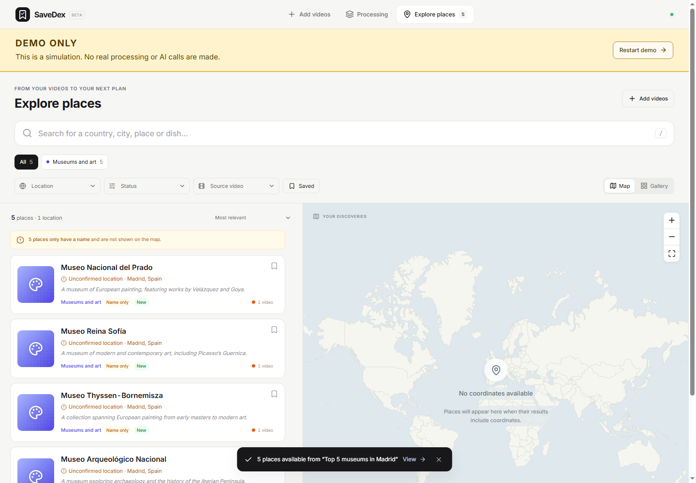
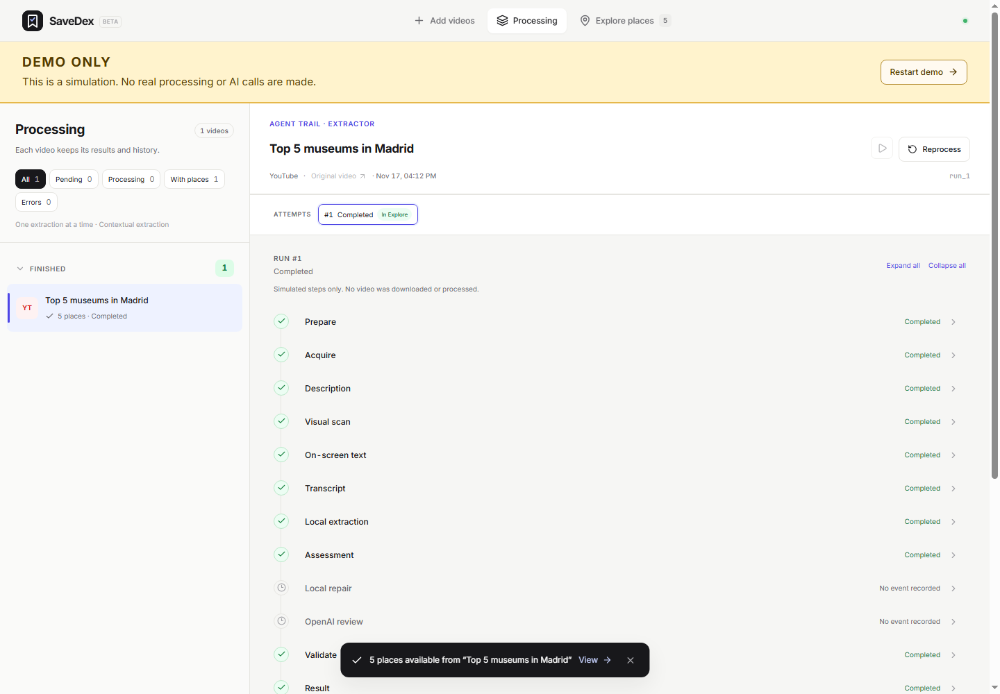

# SaveDex

A local web app for turning saved Instagram and YouTube videos into a searchable place library. Review extracted information with its supporting evidence, explore places on a map and research missing location details with a local agent.

## Live demo

[Try the public demo](https://enros7500.github.io/savedex/). It uses a fixed, illustrative dataset of five Madrid museums and can be reset at any time.

**DEMO ONLY — This is a simulation. No real processing or AI calls are made.** The sample video URL is masked, processing is simulated and agent responses are predefined. Museum names and coordinates illustrate the interface; they are not a ranking or current travel guidance.

## Screenshots

All screens show the English demo with illustrative data. No personal library or real extraction results are shown.

**Explore places**



<details>
<summary>Add a video</summary>


</details>

<details>
<summary>Processing: follow a video's progress</summary>



</details>

<details>
<summary>Place details: review a simulated agent response</summary>


</details>

## Local app and public-demo build

Both versions use the same source and main branch. They are selected at build time, not by a URL parameter or an in-app switch.

| | Local app | Public demo |
|---|---|---|
| Video input | Instagram and YouTube URLs | One fixed, masked sample |
| Processing | Existing local extractor | Browser-only simulation |
| Place research | Installed Codex CLI and its session | Predefined responses |
| Library storage | Local SQLite database | In memory; reset on reload |
| Interface language | English by default; Spanish available | English only |
| Backend connection | Local HTTP API and SSE | None |

**Restart demo** restores the initial state. Each visitor has an independent temporary session. The demo does not download videos, invoke the extractor or models, or connect to the local API. Visitor-initiated links such as Google Maps open an external website.

In the local app, extracted names, titles and evidence retain their source language. The **English / Español** selector stores the interface preference in the browser. Routes use `/#add`, `/#processing`, `/#explore` and `/#results`; older Spanish bookmarks redirect while preserving parameters.

## Run locally

Requires Windows 10 or later, x64, Windows PowerShell/.NET and a browser with JavaScript and EventSource. Browser tests require Chrome or Edge.

From the repository root in PowerShell:

```powershell
.\scripts\setup.ps1
if (-not (Test-Path .env)) { Copy-Item .env.example .env }
```

Before starting, configure the existing [savedex-extractor](https://github.com/enros7500/savedex-extractor) executable, medium model and work directory in `.env`. SaveDex does not install the extractor or download models. The CLI needs its speech, text and OCR resources; `doctor` checks those resources but cannot guarantee anonymous access to every post. Cookies and sign-in are not included.

```powershell
.\scripts\start.ps1
```

Open [SaveDex locally](http://127.0.0.1:3210), or the address printed at startup if you changed `PORT`. Startup builds and serves the interface and API on the same port. Pending work is restored **without automatic processing**; select **Start** to begin.

Setup installs portable Node 22.23.4 and pnpm 10.6.3 under `.tools`, verifies the official download and installs locked dependencies. Existing installations of those versions can also run `pnpm install --frozen-lockfile`.

### Development and demo builds

After building once, run `.\scripts\pnpm.ps1 dev` for live reload. Angular listens on `127.0.0.1:4200` and proxies `/api` to port 3210. Update `apps/web/proxy.conf.json` if the backend port changes.

```powershell
# Local application
.\scripts\pnpm.ps1 build

# Static demo hosted at /
.\scripts\pnpm.ps1 build:demo

# Static demo hosted at /savedex/
.\scripts\pnpm.ps1 build:demo:pages
```

Both demo commands write to `apps/web/dist-demo/browser/`, separately from the normal application build. Serve that directory from a static host. Demo transport and data are replaced at build time; details are in [DEMO.md](DEMO.md).

### Automatic publication

The [Demo · GitHub Pages workflow](.github/workflows/demo-pages.yml) runs for relevant pushes to `main` and can also be started manually. It checks types, runs synthetic tests, builds the app and demo, and verifies the demo in a browser before publishing. Documentation-only changes do not redeploy.

Only `apps/web/dist-demo/browser/` is uploaded. Environment files, SQLite databases, local extractor configuration and Codex sessions are outside the hosted artifact. Deployment uses GitHub's short-lived Pages permissions. Shared interface improvements reach the demo through the same main branch.

## Processing and place research

Videos are processed sequentially. **Stop** lets the active video finish before pausing the queue. Ctrl+C requests backend shutdown after the active video; closing the browser does not stop extraction. Removing a completed attempt from Processing hides it in that browser while retaining history and providing Undo. Pending or active work stays visible.

Instagram titles use public HTML metadata without downloading media. If metadata is unavailable, the URL remains the title. A title never counts as an extracted place. Completed attempts without places appear under **Needs attention**.

Place research uses the installed Codex CLI, its existing ChatGPT session and `gpt-6-sol`. It consumes session usage and consults web sources using the place's name, address and location context. Confirmed coordinates, descriptions and sources are stored separately from the original extraction; ambiguous places remain pending review. Up to two photos may be returned when their reuse can be confirmed.

Research runs one task at a time in an ephemeral read-only sandbox with a 180-second limit. Interrupted tasks can be retried and do not restart automatically. Set `SAVEDEX_CODEX_EXE` in `.env` to override the CLI path.

## Validation

```powershell
.\scripts\pnpm.ps1 typecheck
.\scripts\pnpm.ps1 test
.\scripts\pnpm.ps1 build
.\scripts\pnpm.ps1 test:e2e:all
```

Browser journeys cover processing, catalog, language persistence, place research and contextual extraction. They use temporary SQLite databases and simulated extractors/agents. Reports and screenshots stay under `.cache/`. These checks do not process personal data or invoke models.

To validate the Pages demo separately:

```powershell
.\scripts\pnpm.ps1 build:demo:pages
$env:SAVEDEX_DEMO_BASE_PATH='/savedex/'
.\scripts\pnpm.ps1 test:e2e:demo
```

The demo suite checks the full journey, five agent responses, English despite a stored Spanish preference, mobile layout, reduced motion, reset/reload and the absence of API/SSE/fetch calls or external resource requests.

<details>
<summary>Extractor verification and historical acceptance</summary>

```powershell
.\scripts\pnpm.ps1 extractor:verify
.\scripts\pnpm.ps1 contracts:generate
```

Extractor verification expects the sibling repository `../savedex-extractor` with its existing Windows installation under `work/asr-venv`. It checks synthetic fixtures, version, diagnostics and a controlled invalid request without processing real URLs or changing extractor code. Generated TypeScript types follow the extractor's JSON Schemas; progress events use a separate protocol.

The default extractor budget is 900 seconds plus a 20-second shutdown grace period. A `partial` result with exit code 2 is valid and retains its review reasons. Schema checks cover structure; extractor validation also checks references and semantic rules.

Historical real-media acceptance covered ten URLs: five successes, two partial results and three errors. A separate top-ten case returned two items with eight missing; exhaustive reprocessing did not improve recovery. Synthetic tests do not repeat those real extractions. Real-media acceptance is an explicit, separate operation using `scripts/acceptance-real.mjs`, the network and existing models. Its database stays under `.cache/delivery-7/real/`.

Historical delivery checks remain in `scripts/verify-delivery-1.mjs` through `scripts/verify-delivery-7.mjs`. Some require the sibling extractor, Chrome/Edge or free ports 3210/4200. Historical reports stay local because they may contain personal video metadata.

</details>

## Project structure

- `apps/web/`: Angular interface, shared screens and isolated demo runtime.
- `apps/api/`: local API, SQLite persistence, queue, extractor adapter and place agent.
- `packages/contracts/`: API contracts, extractor schemas and generated types.
- `scripts/`: Windows setup, startup, verification and maintenance tools.
- `tests/`: synthetic fixtures, unit tests and browser journeys.
- `assets/readme/`: reviewed screenshots of the public demo.

The local app uses HTTP and SSE on one loopback origin. A sequential worker invokes the existing extractor and stores results in SQLite.

## Privacy and local data

Application data defaults to `data/savedex.sqlite`. Set `SAVEDEX_DATABASE` to use another persistent location. Relative paths resolve against the repository root. The root `.env` is loaded independently of the launch directory; existing environment variables take precedence. To back up data, stop the server and copy the database together with its associated SQLite files.

Keep real libraries, extracted media metadata, credentials, environment files, browser profiles and generated reports private. `.gitignore` excludes `.env`, databases, `data/`, `.cache/`, local tools and historical `docs/` reports. The screenshots above contain only the demo's illustrative dataset. The extractor's bundled schema license is included at `packages/contracts/schemas/EXTRACTOR-LICENSE`; dependencies retain their own licenses.

## Tentative roadmap

- **V2:** library organization, more flexible search and multi-URL import.
- **V3:** review tools and tracking for incomplete collections.
- **V4:** packaged local distribution and portable storage.

These items are outside V1. Further Output refinement is planned for a later phase.
