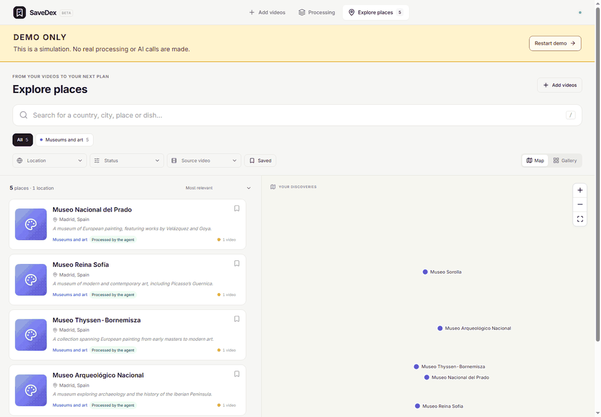
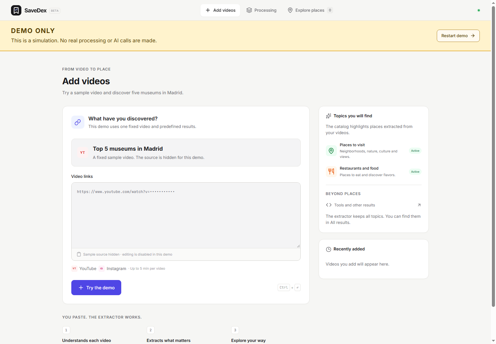
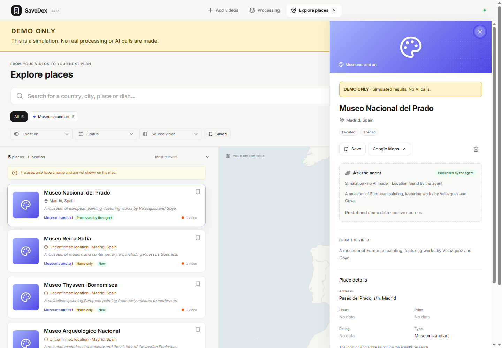

# SaveDex

**Turn saved Instagram and YouTube videos into a searchable place library.**

Review extracted information and its supporting evidence, explore places on a map, and research missing location details with a local agent.

[**Try the live demo**](https://enros7500.github.io/savedex/) · [**Watch the walkthrough**](#walkthrough) · [**Run locally**](#run-locally)

> **Demo only:** The public demo uses five illustrative Madrid museums. Video processing and agent responses are simulated; no real processing or AI calls are made. The sample URL is masked, and the data is not current travel guidance.

[](https://enros7500.github.io/savedex/)

*The demo after running its five predefined research responses. Locations are added by simulated research, separately from the original sample extraction.*

## Walkthrough

See the result first, then follow the current English demo from its fixed sample video through processing, five museum results and simulated location research.



*Recorded from the actual demo interface with illustrative data. The animation preserves the simulation notices; it does not show real extraction or live research.*

[Try the same journey yourself →](https://enros7500.github.io/savedex/)

## From saved video to useful places

### Recover places from saved videos

Add an Instagram or YouTube URL to the local app and start the processing queue when you are ready. Extracted places become a searchable library. Follow each video's progress and review incomplete results.

<details>
<summary>See the sample input and completed processing</summary>




</details>

### Review information in context

Search and filter places, open their details, and trace them back to the source video. The local app retains the extractor's supporting evidence and review reasons. Missing details stay missing until additional information is available.

The public demo illustrates the interface with fixed sample content; it does not demonstrate extraction accuracy or real source evidence.

### Research missing location details

Use place research to investigate a place's location and description in the local app. Research is stored separately from the original extraction, and ambiguous matches remain pending review. In the demo, **Ask the Agent** reveals a predefined response.

<details>
<summary>See a predefined research response in the demo</summary>



</details>

## Try the demo

[Open the public demo](https://enros7500.github.io/savedex/) — no account or local setup needed.

1. Add the fixed sample video, then select **Start queue**.
2. Wait for simulated processing to finish and open **Explore places** to find five Madrid museums.
3. Open a museum and select **Ask the Agent**. Its predefined response adds an address and map location.
4. Repeat for the other museums to populate the map, or select **Restart demo** to begin again.

Each visitor has an independent temporary session. Restart or reload clears it. The demo cannot process your own URLs, download videos or invoke models. Explicit links such as Google Maps open an external website.

| | Local app | Public demo |
|---|---|---|
| Input | Instagram and YouTube URLs | One fixed, masked sample |
| Processing | Existing local extractor | Browser-only simulation |
| Place research | Installed Codex CLI and its session | Predefined responses |
| Storage | Local SQLite database | In memory; reset on reload |
| Language | English or Spanish | English |

[Demo runtime and hosting](DEMO.md) · [Local app behavior and privacy](LOCAL-APP.md)

## Run locally

Requires Windows 10 or later, x64, Windows PowerShell/.NET and a browser with JavaScript and EventSource. Browser tests require Chrome or Edge.

From the repository root in PowerShell:

```powershell
.\scripts\setup.ps1
if (-not (Test-Path .env)) { Copy-Item .env.example .env }
```

Before starting, configure the existing [savedex-extractor](https://github.com/enros7500/savedex-extractor) executable, medium model and work directory in `.env`. SaveDex does not install the extractor or download models. The CLI needs its speech, text and OCR resources; `doctor` checks those resources but cannot guarantee anonymous access to every post. Cookies and sign-in are not included.

```powershell
.\scripts\start.ps1
```

Open [SaveDex locally](http://127.0.0.1:3210), or the address printed at startup if you changed `PORT`. Startup builds and serves the interface and API on the same port. Pending work is restored **without automatic processing**; select **Start** to begin.

Setup installs portable Node 22.23.4 and pnpm 10.6.3 under `.tools`, verifies the official download and installs locked dependencies. Existing installations of those versions can also run `pnpm install --frozen-lockfile`.

## Documentation

- [Local app guide](LOCAL-APP.md): processing, research, language, privacy and backups.
- [Development and validation](DEVELOPMENT.md): builds, tests, project structure and tentative roadmap.
- [Public demo guide](DEMO.md): isolated runtime, GitHub Pages publication and media refresh.

Application data stays in a local SQLite database by default. Place research uses the installed Codex CLI and its existing ChatGPT session, consumes session usage and consults web sources. See the [local app guide](LOCAL-APP.md#privacy-and-local-data) before working with a personal library.
